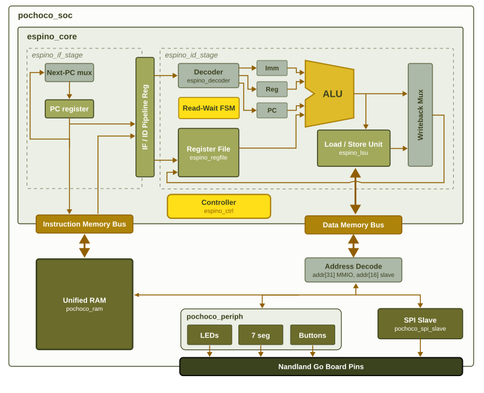

> **Revisión del juego:** instrucciones actuales, mapa MMIO y pruebas en [REVISION.md](REVISION.md).

# Pochoco SoC & Espino Core

> Meet Pochoco SoC and Espino Core. Inspired by the native flora of the Pochoco trails, it is an entry-level, highly efficient architecture designed to flourish in resource-constrained environments.



Welcome to the repository! This project contains the RTL for a custom 32-bit processor and its surrounding System-on-Chip (SoC) designed for FPGA deployment. The design is kept straightforward to help explore and understand computer architecture fundamentals.

This is meant to be forked, not just cloned. You'll be poking around the RTL, so make it your own, we won't judge (we might even be a little proud).

## Repository Structure

The hardware is written in Verilog and divided into these main categories:

* **The Espino Core**: The central processing unit. It includes all standard pipeline stages like instruction fetch, instruction decode, an ALU for execution, a register file, a load/store unit for memory operations, and a pipeline controller. It implements [RV32E](https://docs.riscv.org/reference/isa/v20260120/unpriv/rv32.html) with a catch you might want to check out the code for.
* **The Pochoco SoC**: The top-level system wrapper. It connects the CPU core to a unified instruction/data RAM, physical board peripherals (like LEDs, switches, and displays), and an external SPI slave interface.
* **Build Files**: Constraints to map the design to the physical FPGA pins, and automation scripts for synthesis, routing, and flashing using an open-source toolchain.

## Memory Map

The SoC routes memory and data requests using a hardcoded address decoding scheme based on the highest bits of the 32-bit address.

* **`0x0000_0000` - Unified RAM**: The shared memory space for both instructions and data.
* **`0x8000_0000` - Board Peripherals**: Memory-mapped I/O for the physical board.
  * `Offset 0x00`: 7-Segment Displays
  * `Offset 0x04`: LEDs
  * `Offset 0x08`: Button Inputs
* **`0x8001_0000` - SPI Slave**: Custom SPI interface routing.
  * `Offset 0x00`: SPI Status (Chip Select state, New Data flag)
  * `Offset 0x04`: Received "Price" byte (from external master)
  * `Offset 0x08`: "Decision" byte (written by CPU to transmit)

Dive into the source code to see exactly how these components and connections are built under the hood!

## How to Build

To synthesize and build the project, you will need the open-source FPGA toolchain.

1. Install the tools by following the instructions at the [oss-cad-suite-build repository](https://github.com/yosyshq/oss-cad-suite-build).
2. Once installed, ~~blindly copy-paste~~ (we strongly encourage reading the Makefile first to make sure we aren't deleting your home directory) the following command in the project root to generate and program the final bitstream:

```bash
make all   # build only; use make prog to flash
```

## Software

The `sw/` folder contains the game and RV32E examples. Use the project assembler:

```sh
python sw/assembler.py sw/game.s -o sw/game.hex
python -B tests/run_tests.py
```

From `sw/`, `make` builds all examples using the same Python assembler. The top-level
build regenerates the game image automatically. No external RISC-V assembler is needed.

Shifts are intentionally absent from the ALU to save LUTs. The assembler rejects
them and the hardware decoder suppresses their side effects. See [REVISION.md](REVISION.md)
for the supported subset, game timing, updated MMIO registers and verification limits.

## Proyecto 3: adaptación ASIC

Este repositorio conserva el Proyecto 2 para la FPGA Lattice iCE40 HX1K y
añade un flujo ASIC reproducible. `rtl/game_top.v`, `rtl/pochoco_ram.v`, el
PCF y los targets FPGA permanecen disponibles; `rtl/asic_top.v` es el top
ASIC con reset externo activo en bajo y sin asignaciones físicas de pines.
El SoC puede elaborar dos memorias ASIC:

* `MemoryArchitecture=1`: ROM combinacional generada + RAM de datos reducida
  (candidata principal por área).
* `MemoryArchitecture=2`: memoria unificada implementada con flip-flops.

La plataforma validada es WSL2 + Docker, LibreLane **3.0.16**, PDK
`gf180mcuD` de `open_pdks` revisión
`8afc8346a57fe1ab7934ba5a6056ea8b43078e71` y biblioteca estándar
`gf180mcu_fd_sc_mcu7t5v0`. El reloj reglamentario es de 100 ns (10 MHz). El
debounce conserva 10 ms en ambas plataformas: 250000 ciclos por defecto para
FPGA a 25 MHz y 100000 ciclos desde `asic_top` para ASIC a 10 MHz.

### Entorno WSL y LibreLane

Docker Desktop debe estar iniciado y con integración habilitada para la
distribución WSL. Desde WSL, en la raíz del repositorio:

```sh
docker info
docker run --rm hello-world
python3 -m venv .venv-librelane-stage3
. .venv-librelane-stage3/bin/activate
python3 -m pip install 'librelane==3.0.16'
python3 -m librelane --dockerized --smoke-test
```

La instalación verificada tiene el PDK habilitado bajo `~/.ciel/gf180mcuD`.
Los targets usan `--manual-pdk`; si el PDK está en otra ubicación, exporte
`PDK_ROOT` antes de ejecutar `make`. Debido a los espacios de la ruta de
Windows, las corridas verificadas usan un enlace WSL sin espacios:

```sh
ln -s '/mnt/c/ruta/absoluta/al/pochoco_soc-main' /tmp/pochoco3
cd /tmp/pochoco3
```

No vuelva a crear el enlace si ya apunta al proyecto correcto.

### Programa y verificaciones RTL

El programa entregable sigue siendo `sw/game.s`, con diez rondas. Estos
targets regeneran de forma determinista sus imágenes:

```sh
make asic-rom          # sw/game.hex y rtl/game_rom.v desde sw/game.s
make asic-rom-100ns    # imagen ASIC de 100 ns en asic/generated/
python3 -B tests/run_tests.py
make asic-stage4-check # elabora ambas arquitecturas ASIC con Icarus
```

`sw/game_asic_100ns.s` es la variante reproducible para el reloj ASIC; no
reemplaza ni modifica `sw/game.s`.

### Síntesis y flujo físico

```sh
make asic-synth-rom-ram ROM_RAM_SYNTH_TAG=mi_sintesis_rom_ram
make asic-synth-unified-ff UNIFIED_SYNTH_TAG=mi_sintesis_unified
make asic-full-rom-ram ROM_RAM_FULL_TAG=mi_flujo_rom_ram
make asic-full-unified-ff UNIFIED_FULL_TAG=mi_flujo_unified
```

La referencia obligatoria para la entrega es ROM+RAM con
`CLOCK_PERIOD=100` ns y `FP_CORE_UTIL=40`, definidos en
`asic/rom_ram_util40.json`. Use una etiqueta nueva para no sobrescribir una
corrida previa:

```sh
make stage9-regulatory ETAPA9_TAG=mi_corrida_rom_ram_100ns_util40
```

El deck KLayout DRC instalado se puede repetir sobre esa corrida sin editar
sus reglas (instale antes `docopt` en el directorio aislado si no existe):

```sh
python3 -m pip install --target reports/stage9/python_deps docopt==0.6.2
make stage9-klayout-drc \
  ETAPA9_TAG=mi_corrida_rom_ram_100ns_util40 \
  STAGE9_KLAYOUT_DIR=reports/stage9/klayout_drc_mi_corrida
```

Los targets `asic-stage5-util30`, `asic-stage5-util50` y los de Etapas 6/6B
son experimentos, no sustituyen la referencia de 40 %. La ALU usada por la
referencia es `asic/baseline/espino_alu.v`; la variante optimizada de Etapa 4
no es candidata.

### Simulación post-síntesis

Para crear primero un netlist nuevo y luego reproducir los casos RTL/gate:

```sh
make stage7-synth ETAPA7_TAG=etapa7_rom_ram_post_synth_repro
make stage7-run ETAPA7_TAG=etapa7_rom_ram_post_synth_repro
```

La comparación queda en `tests/stage7/evidence/comparison.txt`; los logs y
VCD están en `tests/stage7/evidence/`. La ejecución documentada obtuvo
`mismatches=0` para los casos probados.

### Resultados y estado real

* Corridas y logs originales: `asic/runs/<etiqueta>/`.
* Vistas finales de cada corrida: `asic/runs/<etiqueta>/final/`.
* GDS candidatos: `final/gds/asic_top.gds` y
  `final/klayout_gds/asic_top.klayout.gds`.
* Reportes consolidados: `reports/` y documentación de cada etapa en `docs/`.
* Evidencia de layout: `docs/figures/`.

La **referencia reglamentaria** es `etapa9_rom_ram_util40_debounce`
(100 ns, 40 %): 2695/10/58 violaciones de slew/capacitancia/fanout;
setup y hold cumplen en nueve corners y routing DRC, Magic DRC, KLayout DRC
externo, LVS y antena están limpios. El die mide 0,375554 mm².

La **mejor candidata técnica previa a Etapa 21** es `etapa12_rom_ram_no_delay_ss`, con los
mismos 100 ns y 40 %: 440/2/57 violaciones. Su peor slack real de setup y
hold es +53,646852/+0,054793 ns; también tiene DRC, LVS, antena y KLayout
externo limpios. Los experimentos de Etapa 13 no la sustituyen: el post-GRT
dio 410/3/57, y la redistribución CTS 468/1/0. Ninguno cierra todas las
condiciones eléctricas. Consulte `docs/proyecto3_etapa12.md` y
`docs/proyecto3_etapa13.md`, con datos fuente en `reports/stage12/` y
`reports/stage13/`.

Las corridas reglamentarias y experimentales anteriores son candidatos
históricos. La Etapa 21 alcanza cierre eléctrico del macro, pero no es una
certificación de chip completo. Tampoco se definieron `PNR_SDC_FILE` ni
`SIGNOFF_SDC_FILE` de interfaz ASIC específica: la STA usa restricciones
SDC genéricas de LibreLane.

### Cierre eléctrico Etapa 21

La corrida validada `etapa21_combined` parte de `etapa20_group3` y aplica
ECO físico localizado manteniendo 100 ns y 40 %. Sus métricas post-route son
slew/capacitancia/fanout = **0/0/0**, setup WNS mínimo +53,053929 ns y hold
WNS mínimo +0,006720 ns. El área de celdas es 187808 µm² y la utilización
0,541139. Routing DRC, Magic DRC, LVS, antena, XOR y PDN están limpios; el
deck GF180MCU de KLayout ejecutado externamente también reportó cero errores.

Los artefactos correspondientes son:

```text
asic/runs/etapa21_combined/final/gds/asic_top.gds
asic/runs/etapa21_combined/final/nl/asic_top.nl.v
asic/runs/etapa21_combined/final/spef/{min,nom,max}/
reports/stage21_etapa21_combined.lyrdb
docs/proyecto3_etapa21.md
```

La copia exacta del netlist final seleccionada para entrega es
`reports/entrega/etapa21_combined_final.nl.v`; `etapa21_combined_gate.nl.v` es
solo el adaptador con nombre `asic_top_gate` usado por el testbench externo.

El GDSII es un candidato de macro ASIC cerrado bajo las restricciones
disponibles, no una certificación de chip completo con pad ring, ESD ni
modelos de I/O. La métrica KLayout integrada de LibreLane permanece sin
reportar porque `KLAYOUT_DRC_RUNSET` no está definido para gf180mcuD; el
resultado externo está conservado en `reports/stage21_etapa21_combined.lyrdb`.

La validación funcional del cierre tiene cobertura limitada y trazable. La
comparación externa de Etapa 21 cubrió 208 ciclos con `mismatches=0`; el
benchmark RTL/gate-level pareado cubrió 1008 ciclos con `mismatches=0` en
LEDs, displays y SPI. Icarus gate-level alcanza aproximadamente 234 ciclos/s,
por lo que no se ejecutaron las esperas completas de 30 millones de ciclos,
el caso incorrecto ni las diez rondas en el netlist final. Verilator 5.020
aceleró el RTL, pero rechazó los UDP y strength specifications de los modelos
GF180MCU; no se declara equivalencia exhaustiva ni formal.

Las evidencias reproducibles de estas etapas están en `tests/stage21/`,
`tests/stage22/`, `tests/stage23/`, `reports/stage21/`, `reports/stage22/` y
`reports/stage24/`.

### Informe y entrega reproducible

El informe fuente está en `docs/informe_proyecto3/main.tex` y el paquete
autocontenido para Overleaf en `docs/Proyecto3_Overleaf.zip`. Se compila
con pdfLaTeX y BibTeX; no necesita `--shell-escape`. No hay un PDF local
verificado en esta copia del proyecto.

Los comandos anteriores existen en `Makefile`; los lanzadores de las
Etapas 12 y 13 se reproducen desde WSL con una etiqueta nueva, sin
sobrescribir las corridas originales:

~~~sh
python3 scripts/stage12_run.py asic/rom_ram_stage12_no_delay_ss.json \
  --tag etapa12_repro_no_delay_ss
python3 scripts/stage13_run.py asic/rom_ram_stage13_postgrt.json \
  --tag etapa13_repro_postgrt
python3 scripts/stage13_run.py asic/rom_ram_stage13_cts.json \
  --tag etapa13_repro_cts
~~~

El árbol completo `asic/runs/` se conserva localmente como evidencia original
y es demasiado voluminoso para GitHub. El archivo `.gitignore` impide subir
sus intermedios; `reports/` conserva localmente los resúmenes y logs,
pero algunos logs con rutas personales y volcados grandes tampoco se
publican. `reports/entrega/` contiene una selección verificable de
métricas, reportes y GDSII candidatos. Véase
`docs/entrega_proyecto3.md` para distinguir evidencia incluida de
archivos que permanecen solo en disco.
