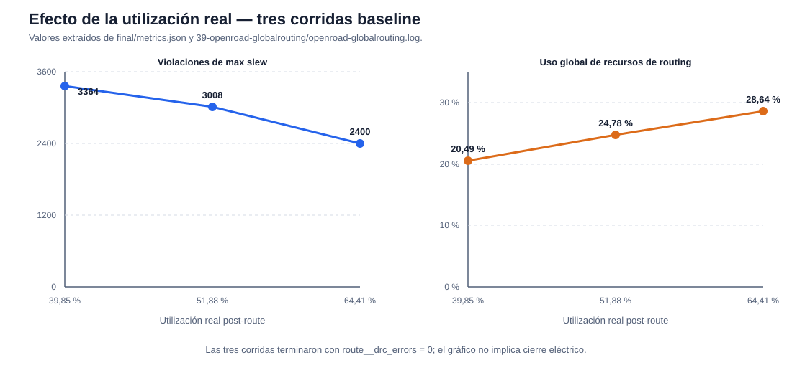
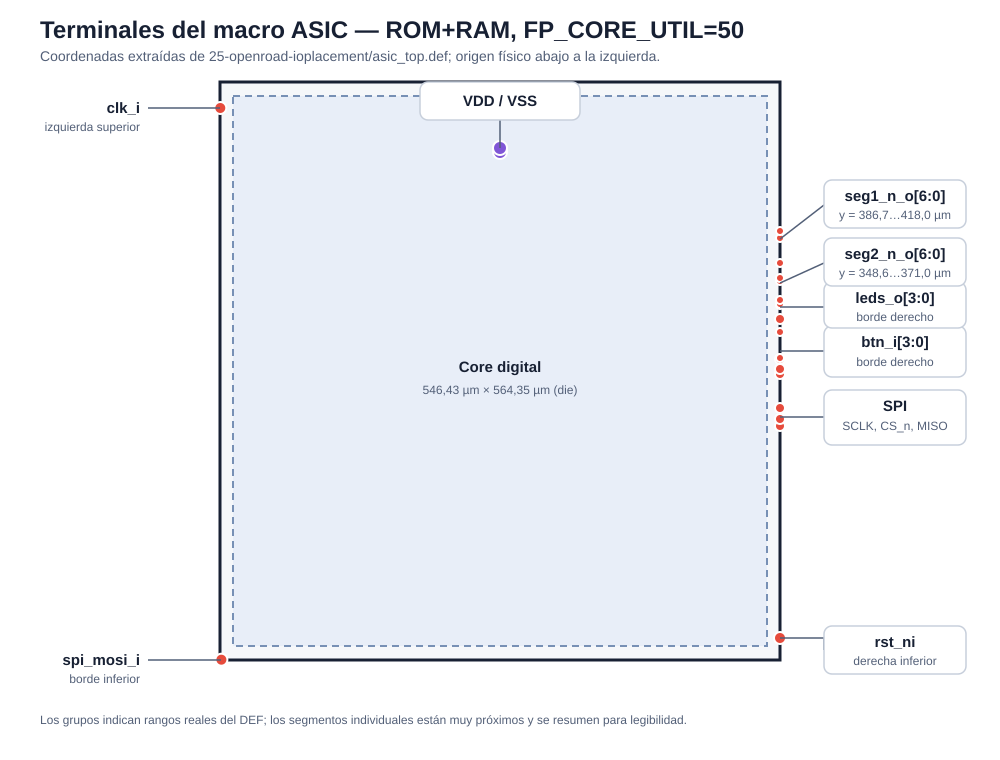

# Proyecto 3 — Etapa 5: floorplan, alimentación, placement y costo

## Alcance y criterio de cierre

Se usó LibreLane 3.0.16, PDK `gf180mcuD` revisión `8afc8346a57fe1ab7934ba5a6056ea8b43078e71`, biblioteca `gf180mcu_fd_sc_mcu7t5v0`, `CLOCK_PERIOD=100 ns` y la arquitectura ASIC baseline ROM combinacional + RAM reducida (`MemoryArchitecture=1`). La imagen es `asic/generated/game_rom.v` y la ALU es `asic/baseline/espino_alu.v`; no se usó la ALU experimental de Etapa 4. Los resultados anteriores no se sobrescribieron.

Se considera cierre válido únicamente si pasan setup y hold en los nueve corners, routing DRC, DRC disponible, LVS, antena y comprobaciones eléctricas. “Flow complete” no implica por sí solo cierre físico. KLayout DRC no pudo ejecutarse porque esta instalación del PDK no define `KLAYOUT_DRC_RUNSET`; Magic DRC sí se ejecutó.

## Configuraciones y comandos reproducibles

Los tres puntos solicitados están en `asic/rom_ram_util30.json`, `asic/rom_ram_util40.json` y `asic/rom_ram_util50.json`. Los targets son:

```sh
cd /tmp/pochoco3
make asic-stage5-util30
make asic-stage5-util40
make asic-stage5-util50
```

Sus etiquetas son `etapa5_rom_ram_util30`, `etapa5_rom_ram_util40` y `etapa5_rom_ram_util50`. Cada una ejecutó el flujo `Classic` completo y generó GDS con Magic y KLayout, render, Magic DRC, extracción SPICE y Netgen LVS.

Como ninguna de las tres cerró eléctricamente, se ensayaron configuraciones adicionales, sin cambiar RTL ni juego:

- `etapa5_rom_ram_util50_repair`: reparación de diseño post-global-routing.
- `etapa5_rom_ram_util50_fanout4`: fanout de síntesis 4 y reparación post-routing; falló en global routing por congestión.
- `etapa5_rom_ram_util40_fanout4`: mismo fanout con más área; completó, pero conservó violaciones eléctricas.
- `etapa5_rom_ram_util50_buf4`: buffer de síntesis `gf180mcu_fd_sc_mcu7t5v0__buf_4` y reparación post-routing; completó, pero empeoró las violaciones.

## Resultados de los tres floorplans

El área de celdas de placement se toma de `28-openroad-globalplacement/state_out.json`; el área estándar post-route excluye fillers y se toma de `final/metrics.json`. El área de core y die incluye el espacio físico correspondiente, por lo que no debe confundirse con el área de celdas.

| `FP_CORE_UTIL` | Densidad objetivo GPL | Celdas placement (µm²) | Stdcell post-route (µm²) | Core (µm² / mm²) | Die (µm² / mm²) | Utilización real post-route |
|---:|---:|---:|---:|---:|---:|---:|
| 30 % | 43,3188 % | 157 181 | 187 986 | 471 748 / 0,471748 | 504 709 / 0,504709 | 39,8488 % |
| 40 % | 53,2430 % | 153 524 | 184 179 | 355 025 / 0,355025 | 382 215 / 0,382215 | 51,8778 % |
| 50 % | 63,6994 % | 151 341 | 181 532 | 281 831 / 0,281831 | 308 378 / 0,308378 | 64,4117 % |

`FP_CORE_UTIL` determina el tamaño inicial del core; no es igual a la utilización final. CTS, buffers de reparación, taps, endcaps, diodos y fillers cambian el área ocupada durante el flujo.

### Routing, timing y cierre

En los nueve corners (`nom`, `min`, `max` × TT 25 °C/5,00 V, SS 125 °C/4,50 V y FF −40 °C/5,50 V), las tres corridas tienen setup WNS = 0, setup TNS = 0, hold WNS = 0 y hold TNS = 0. LibreLane limita WNS a cero cuando el slack es positivo; por eso se incluye el peor slack real (`WS`). El peor setup ocurre en `max_ss_125C_4v50` y el peor hold en `min_ff_n40C_5v50`.

| Util. solicitada | Uso global routing | Overflow global | DRC Triton inicial → final | Setup WS peor (ns) | Hold WS peor (ns) | Slew / cap / fanout | Antena | Magic DRC | LVS | Estado |
|---:|---:|---:|---:|---:|---:|---:|---:|---:|---:|---|
| 30 % | 20,49 % | 0 | 16 → 0 | +36,001 | +0,133 | 3364 / 26 / 58 | 0 | 0 | 0 | Flujo completo; no cierre eléctrico |
| 40 % | 24,78 % | 0 | 152 → 0 | +38,023 | +0,137 | 3008 / 31 / 56 | 0 | 0 | 0 | Flujo completo; no cierre eléctrico |
| 50 % | 28,64 % | 0 | 24 → 0 | +40,598 | +0,123 | 2400 / 1 / 55 | 0 | 0 | 0 | Flujo completo; no cierre eléctrico |

También son cero las diferencias XOR, violaciones de power grid, pines críticos desconectados e illegal overlaps. KLayout DRC aparece como no ejecutado, no como cero, porque falta el runset. El warning de una entrada del macro sin información de antenna gate corresponde a la interfaz superior y debe revisarse al integrar pads.



La utilización mayor redujo el die y la longitud global de cable: 589 789 µm, 553 593 µm y 525 378 µm para 30, 40 y 50 %. Aunque el porcentaje de recursos usados sube, no hubo overflow. El conteo de DRC inicial no fue monótono —40 % comenzó con 152—, pero TritonRoute llevó las tres corridas a cero.

### Búsqueda de una configuración eléctricamente válida

| Variante adicional | Etapa alcanzada | Stdcell (µm²) | Setup WS SS (ns) | Slew / cap / fanout | Resultado |
|---|---|---:|---:|---:|---|
| 50 % + repair post-GRT | Flujo completo | 180 790 | +41,406 | 2431 / 1 / 55 | No mejoró slew |
| 50 % + fanout 4 | Global routing | N/D | N/D | N/D | Falló `[GRT-0116]` por congestión |
| 40 % + fanout 4 | Flujo completo | 258 151 | +12,073 | 366 / 1 / 69 | Reduce slew, pero no cierra y aumenta área/carga |
| 50 % + `buf_4` | Flujo completo | 181 493 | +33,062 | 2849 / 14 / 54 | Empeora slew/capacitancia |

La evidencia apunta a redes de selección de alto fanout del register file: por ejemplo, el netlist baseline usa `fanout428`, celda `buf_1`, para alimentar diez entradas del multiplexor de lectura. La reparación post-GRT encontró 38 redes, redimensionó 34 instancias y declaró cero antes de RCX, pero las violaciones reaparecieron con parasíticos extraídos. Fanout 4 redujo el problema, a costa de congestión, área y margen setup. No se encontró una configuración que satisfaga todos los criterios; resolverlo probablemente requiere una estrategia de buffering/árbol de mux específica o una modificación microarquitectónica verificada, además de constraints de interfaz reales.

## Área mínima

- **Área mínima probada entre los tres puntos solicitados:** `FP_CORE_UTIL=50`, die de **0,308378 mm²**.
- **Área mínima con flujo completo:** también 50 %, dentro de esos tres puntos.
- **Área mínima que cierra todos los criterios:** **no demostrada**. Las tres corridas base y las variantes completas conservan violaciones eléctricas; además, KLayout DRC no está disponible.

No se afirma un mínimo global: solo se exploraron 30, 40 y 50 %, más tres variaciones físicas y una corrida fallida.

## Alimentación

La red PDN usa `VDD` y `VSS`. Las celdas estándar conectan `VDD`/`VNW` a alimentación y `VSS`/`VPW` a tierra mediante conexiones globales. LibreLane generó rails Metal1 de 0,6 µm, straps verticales Metal4 de 1,6 µm con pitch 153,6 µm y straps horizontales Metal5 de 1,6 µm con pitch 153,18 µm. No se habilitó core ring; sí se habilitaron rails, pins de PDN y conexiones globales.

OpenROAD reportó todas las formas de VDD y VSS conectadas y `design__power_grid_violation__count=0`. Para 50 %, el análisis nominal estimó worst IR drop de 0,000127 V en VDD y 0,000100 V en VSS. Este resultado no es signoff porque no se definió `VSRC_LOC_FILES`; LibreLane advirtió que la ubicación de fuentes puede volver inexacta la estimación.

## Terminales

La corrida 50 % tiene un die de aproximadamente 546,43 × 564,35 µm. No se configuró `FP_PIN_ORDER_CFG` ni placement manual; `OpenROAD.IOPlacement` distribuyó los terminales automáticamente. Por ello, la posición observada se documenta, pero no se presenta como un pinout de paquete optimizado.

| Señal o grupo | Posición física en el DEF de 50 % |
|---|---|
| `clk_i` | izquierda superior, (0,28; 539,00) µm |
| `rst_ni` | derecha inferior, (546,15; 21,56) µm |
| `spi_mosi_i` | borde inferior izquierdo, (1,40; 0,28) µm |
| `spi_sclk_i`, `spi_cs_n_i`, `spi_miso_o` | borde derecho, y = 227,64…244,44 µm |
| `btn_i[3:0]` | borde derecho, y = 278,04…332,92 µm |
| `leds_o[3:0]` | borde derecho, y = 293,72…346,36 µm |
| `seg2_n_o[6:0]` | borde derecho, y = 348,60…371,00 µm |
| `seg1_n_o[6:0]` | borde derecho, y = 386,68…418,04 µm |
| `VDD`, `VSS` | puertos especiales ligados a la malla M4/M5; anchors cerca del centro superior |

La colocación automática separó clock del conjunto de periféricos y agrupó parcialmente SPI, displays, botones y LEDs en el borde derecho, lo que es razonable para routing interno. Sin embargo, MOSI quedó aislado y botones/LEDs se intercalan; no existe una justificación de encapsulado para ese orden. Cambiarlo requiere definir y verificar restricciones de pins, no mover terminales arbitrariamente.



La captura real de KLayout está en `asic/runs/etapa5_rom_ram_util50/59-klayout-render/asic_top.png`:


Los terminales mostrados son puertos del **macro digital**. No son pads físicos: faltan celdas de I/O, protección ESD, level shifters si fueran necesarios, pad ring, bumps/bond pads y planificación del encapsulado. VDD/VSS son accesos a la malla interna, no una definición final de pads de alimentación.

## Estimación académica de costo

Se aplicó literalmente `costo equivalente = área del die en mm² × US$23 000/mm²`:

| Util. | Área de die (mm²) | Cálculo | Costo equivalente |
|---:|---:|---:|---:|
| 30 % | 0,504709 | 0,504709 × 23 000 | US$11 608,31 |
| 40 % | 0,382215 | 0,382215 × 23 000 | US$8 790,95 |
| 50 % | 0,308378 | 0,308378 × 23 000 | **US$7 092,69** |

Es un ejercicio académico de proporcionalidad de área. No incluye NRE, máscaras, MPW/wafer, rendimiento, dies por wafer, volumen, encapsulado, pads, test, logística ni márgenes comerciales; por tanto, no representa una cotización de fabricación.

## Impacto de la arquitectura de memoria

En la comparación de Etapa 4 a 40 %, ROM+RAM tenía 184 179 µm² de stdcells y 0,382215 mm² de die; la unificada tenía 730 205 µm² y 1,470110 mm². La unificada ocupa aproximadamente 3,96 veces más área estándar y 3,85 veces más die. A la misma referencia académica, su die equivaldría a US$33 812,53.

ROM+RAM implementa 143 instrucciones como lógica combinacional y solo una palabra de datos de 32 bits. La unificada materializa 144 palabras de 32 bits con flip-flops, además de la lógica que copia la ROM al arreglo después de reset. Esa multiplicación de registros, reset, clock tree y muxes explica el aumento de área y carga; no debe confundirse con una SRAM compilada.

## Reportes, archivos y pendientes

Para cada corrida base, los originales están en `asic/runs/<tag>/`: `flow.log`, `warning.log`, `error.log`, `28-openroad-globalplacement/state_out.json`, `39-openroad-globalrouting/openroad-globalrouting.log`, `44-openroad-detailedrouting/openroad-detailedrouting.log`, `55-openroad-stapostpnr/state_out.json`, `64-magic-drc`, `70-netgen-lvs` y `final/metrics.json`. Las variantes con repair insertan una etapa y desplazan en uno algunos números; sus `flow.log` y `final/metrics.json` son la referencia autoritativa. La corrida fallida conserva el error completo en `asic/runs/etapa5_rom_ram_util50_fanout4/flow.log`.

Archivos creados o modificados: siete configuraciones base/experimentales en `asic/`, targets reproducibles en `Makefile`, dos SVG en `docs/figures/` y este documento. `sw/game.s`, las diez rondas y el RTL funcional no se modificaron.

Pendientes antes de signoff: eliminar max slew/cap/fanout, crear SDC de PnR/signoff con delays y cargas reales, conseguir/validar un runset KLayout DRC para GF180MCU, definir fuentes de PDN y ejecutar IR drop representativo, diseñar pad ring/I/O, revisar el pin sin antenna gate, habilitar/verificar equivalencia formal y repetir DRC/LVS con la integración completa. No se ejecutó simulación post-síntesis en esta etapa.

## Recomendación

Para continuar el cierre físico se recomienda **ROM+RAM baseline con `FP_CORE_UTIL=50`** como punto de partida: es el menor die probado, tiene cero overflow, cero routing/Magic DRC, cero LVS y antena, el mayor margen setup de las tres corridas y el menor conteo eléctrico baseline. No es una configuración de signoff; la recomendación es para la siguiente iteración de reparación eléctrica, no una declaración de cierre.
